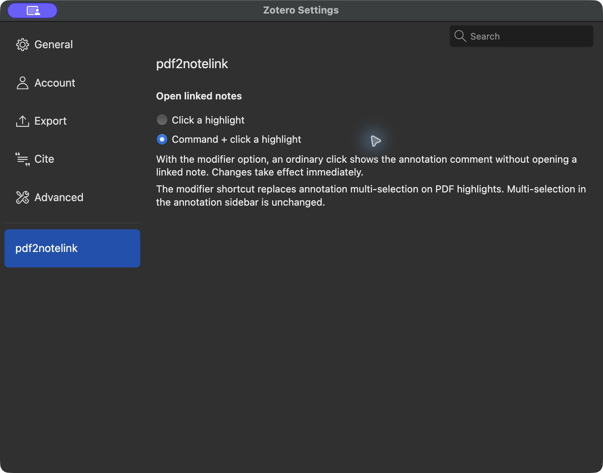
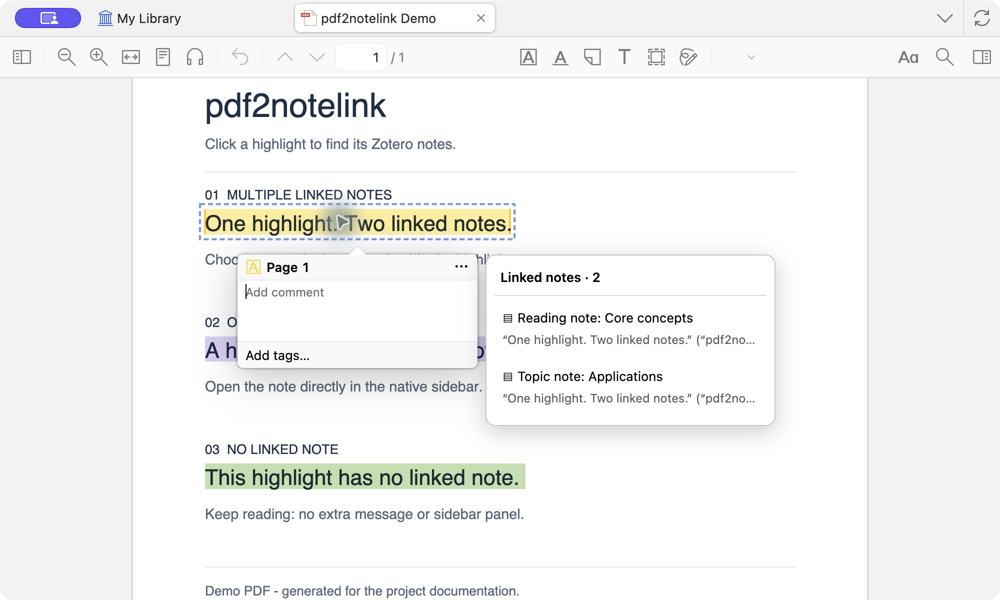
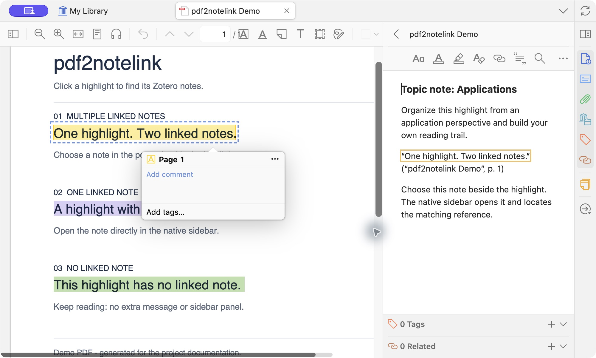
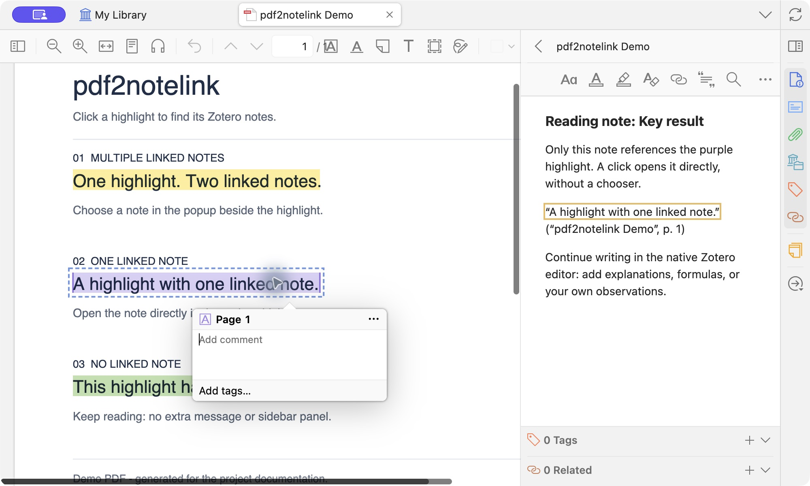
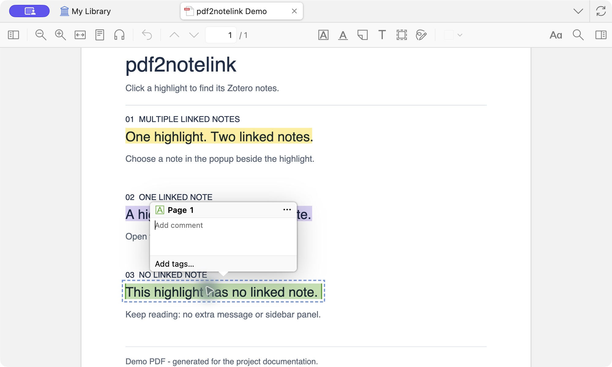

**English** | [Chinese](README.md)

# pdf2notelink

[](https://github.com/Cabdoge/pdf2notelink/actions/workflows/ci.yml)
[](https://github.com/Cabdoge/pdf2notelink/releases/latest)
[](LICENSE)

Click a highlight in a Zotero PDF to open the note that references it in the native sidebar. When several notes reference the same highlight, a compact chooser appears beside it, leaving the sidebar available for the note itself.

## Installation

1. Open the [latest release](https://github.com/Cabdoge/pdf2notelink/releases/latest) and download `pdf2notelink-VERSION.xpi`. Do not download GitHub's automatically generated Source code archives.
2. In Zotero, open **Tools → Plugins**, click the gear menu, and choose **Install Plugin From File…**.
3. Select the downloaded XPI. You can install it over an earlier version.

**Compatibility: Zotero 10.0.5–10.0.6 on macOS and Windows 11.** Linux has not been tested. Use PDF tabs in the main Zotero window. Separate reader windows are not supported.

### Upgrading from a local test build

Local builds through 0.2.0 do not have a working online update URL. Install 0.2.1 or newer manually once. Public releases retain the original plugin ID, `highlight-notes@local.zotero`, so they upgrade the existing plugin rather than installing a second copy.

Public releases provide a Zotero-format `updates.json` through GitHub Releases. With automatic plugin updates enabled, Zotero can check for and install later versions. You can also download the XPI manually. Update checks require access to GitHub.

## Usage

Drag a highlight into a Zotero note, or use Zotero's **Add Note from Annotations**, keeping the native annotation reference intact.

- **No linked note:** no extra message appears, and the sidebar stays as it is.
- **One linked note:** the note opens directly at its reference, with no additional title bar.
- **Several linked notes:** a list of note titles and reference excerpts appears beside the highlight. Selecting a note opens it and closes the chooser.
- Clicking outside, pressing Esc, scrolling the PDF, or switching tabs closes the chooser. If a note references the same highlight several times, the first occurrence is selected.

Copying plain text does not establish a link. Older references containing only page numbers or coordinates, without an annotation key, cannot be matched precisely; drag the highlight into the note again to create a native reference. Manual binding, Obsidian/Markdown notes, links across libraries, and imported embedded PDF annotations are not currently supported.

Starting with 0.2.2, plugin labels follow Zotero's interface language: Chinese for a Chinese interface, and English for other languages. Change Zotero's language and restart Zotero to apply it.

### Choose a trigger (0.3.0+)

Open **Zotero Settings → pdf2notelink** and choose how to open linked notes:

- **Click a highlight:** the default. A click opens its linked note or the note chooser.
- **Command + click a highlight** (macOS) / **Ctrl + click a highlight** (Windows): an ordinary click lets you read and edit the annotation comment. Hold the modifier key while clicking to open linked notes.

Changes apply immediately to all PDF tabs in the main window and persist after restarting Zotero. In modifier mode, the shortcut replaces multi-selection on PDF highlights; the annotation sidebar retains native multi-selection. Dragging or holding extra keys such as Shift or Alt does not open linked notes.



Version 0.3.0 is available for download. The new Ctrl + click gesture is pending native verification on Windows 11.

## Screenshots

These are actual screenshots of **macOS / Zotero 10.0.6 / pdf2notelink 0.2.2**, taken in a separate demo window with an English interface, a generated demo PDF, and English example notes. Yellow, purple, and green highlights demonstrate several linked notes, one linked note, and no linked note respectively.

The **Add comment / Add tags…** popup belongs to Zotero. pdf2notelink adds the **Linked notes** chooser only when more than one note matches.

### Several linked notes: choose beside the highlight

Clicking the yellow highlight shows two linked note titles and reference excerpts beside Zotero's annotation popup. The note sidebar remains collapsed until a note is selected.



Selecting **Topic note: Applications** closes the chooser, opens the selected note in the native sidebar, and locates the matching reference.



### One linked note: open directly

Clicking the purple highlight opens **Reading note: Key result** directly in the native sidebar and locates the reference. No chooser or additional switching panel is added.



### No linked note: keep reading

Clicking the green highlight retains Zotero's annotation popup. The plugin shows no binding prompt and does not expand the note sidebar. If a note is already open, it stays open.



## Data and privacy

The plugin uses Zotero's internal APIs to parse note references locally in the current library. It matches exact library, attachment, and annotation identities, covering both child and standalone notes while excluding deleted notes and notes under deleted parent items.

It does not access SQLite directly, require the local HTTP API, upload notes or PDFs, or collect telemetry. Notes are displayed, edited, and saved through Zotero's native editor. Plugin UI markers are not written into note content. Network access is limited to Zotero's update checks and downloads from the GitHub release source.

## Development and validation

Requires Node.js 18+ and Python 3, with no third-party runtime or build dependencies.

```sh
git clone https://github.com/Cabdoge/pdf2notelink.git
cd pdf2notelink
npm test
npm run build
npm run validate
```

Build outputs are in `dist/`: the XPI, `updates.json`, and `SHA256SUMS`.

- `src/core.js`: reference identity parsing and the reverse index.
- `src/adapter.js`: compatibility with the reader, sidebar, and note editor.
- `src/main.js`: index updates, the chooser, localization, and navigation.
- `tests/`: automated tests and isolated Zotero integration tests.

On macOS with a graphical session, run `python3 scripts/prepare-runtime.py` and launch the isolated profile using the printed command. Test data is written only to a newly created temporary directory. See the [test record](TESTING.md) and [0.2.2 integration results](docs/validation-0.2.2.json). CI runs automated tests and release package validation; it does not simulate Zotero's graphical environment.

## Releases

Distribution uses GitHub Releases and Zotero's [manifest and automatic update format](https://www.zotero.org/support/dev/zotero_7_for_developers#update_rdf_updates_json). This project does not claim to be an official Zotero plugin or to have been accepted into an official or third-party plugin directory.

Maintainers update the version in `manifest.json`, `package.json`, and [CHANGELOG.md](CHANGELOG.md), verify compatibility, and push a `vVERSION` tag. The release workflow tests, builds, validates, and uploads the three release files. The update manifest includes the version, compatibility range, XPI download URL, and SHA-256. Expand the compatibility range only after testing the relevant Zotero versions.

Report problems or suggestions through [Issues](https://github.com/Cabdoge/pdf2notelink/issues). License: [MIT](LICENSE).
