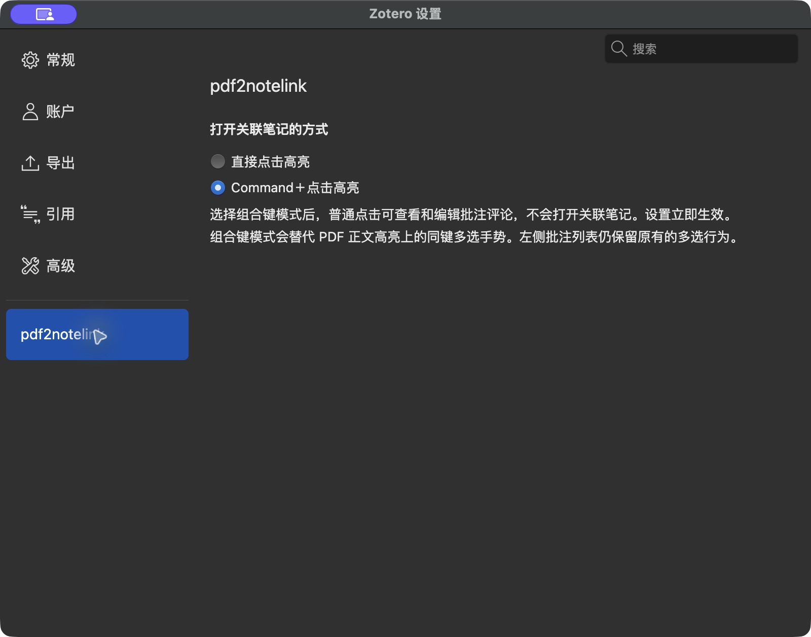
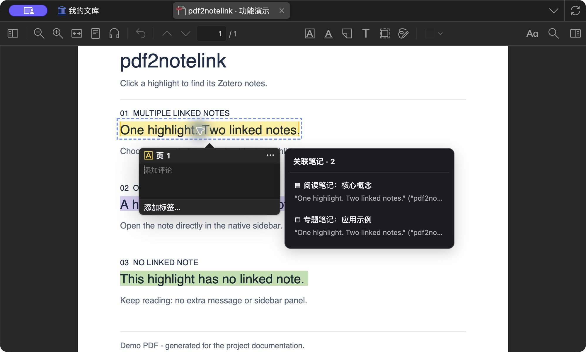
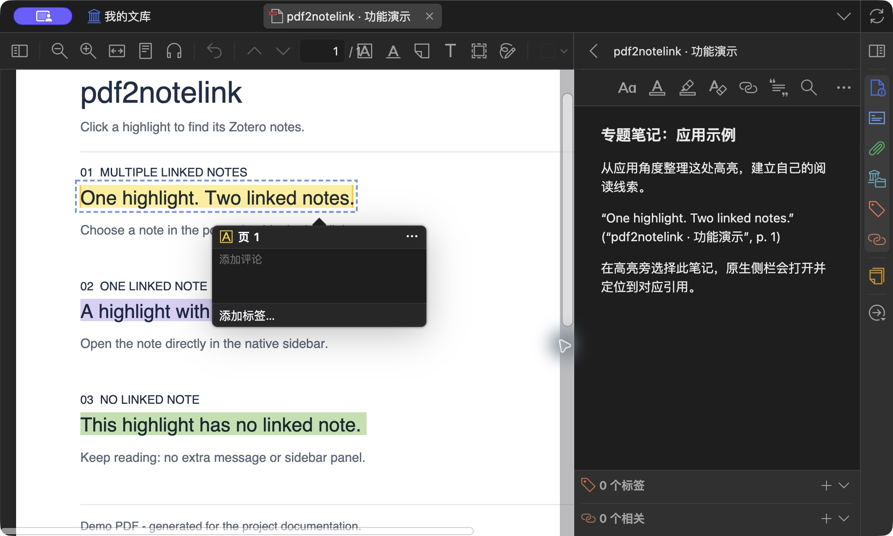
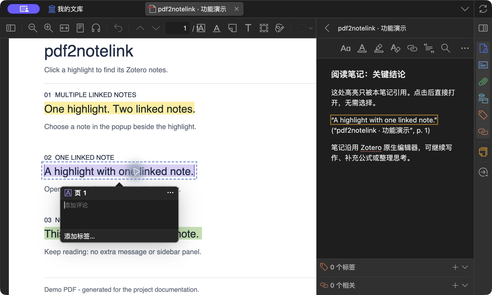
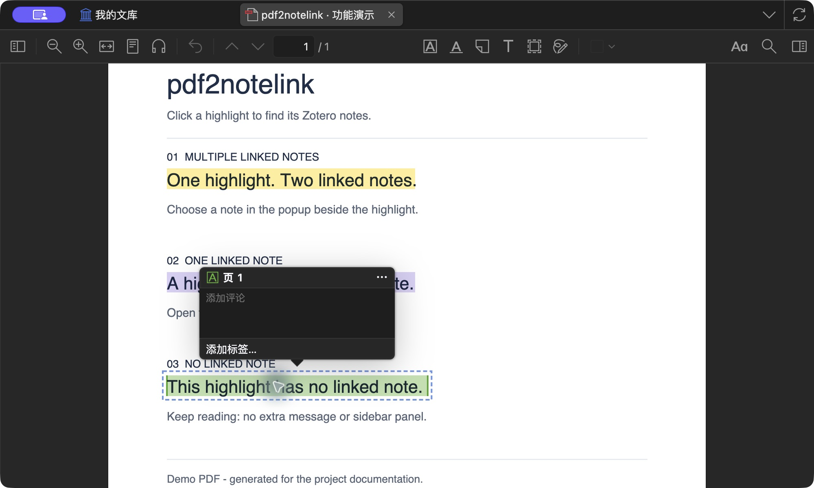

**简体中文** | [English](README.en.md)

# pdf2notelink

[](https://github.com/Cabdoge/pdf2notelink/actions/workflows/ci.yml)
[](https://github.com/Cabdoge/pdf2notelink/releases/latest)
[](LICENSE)

点击 Zotero PDF 正文中的高亮，在原生侧栏打开引用它的笔记。多篇关联笔记以高亮旁的紧凑浮层呈现，侧栏空间留给笔记正文。

## 安装

1. 前往 [最新 Release](https://github.com/Cabdoge/pdf2notelink/releases/latest)，下载 `pdf2notelink-版本号.xpi`。不要下载 GitHub 自动生成的 Source code 压缩包。
2. 在 Zotero 的 **工具 → 插件** 中打开齿轮菜单，选择 **从文件安装插件…**。
3. 选择下载的 XPI；已安装旧版本时可直接覆盖安装。

**兼容范围：Zotero 10.0.5–10.0.6，支持 macOS 和 Windows 11。** Linux 尚未验证。使用 Zotero 主窗口的 PDF 标签页，不支持独立阅读窗口。

### 从本地测试版升级

0.2.0 及更早的本地安装包没有有效的线上更新地址，需要手动安装一次 0.2.1 或更新版本。公开版保留原插件 ID `highlight-notes@local.zotero`，作为原插件升级，不会安装成两个插件。

公开版通过 GitHub Releases 提供 Zotero 格式的 `updates.json`。允许插件自动更新时，后续版本可由 Zotero 检查并安装；也可手动下载 XPI。更新检查需要访问 GitHub。

## 使用

先将高亮拖入 Zotero 笔记，或使用 Zotero 的“从批注添加笔记”，保留原生批注引用。

- **无关联笔记**：保持安静，不显示提示，不展开侧栏。
- **只有一篇**：直接打开并定位，不添加额外标题栏。
- **多篇关联**：在高亮旁弹出标题与摘要列表，选择后打开笔记并收起浮层。
- 点击外部、按 Esc、滚动 PDF 或切换标签页会关闭浮层。同一笔记有多处引用时默认定位第一处。

单纯复制文字不会建立关联；只有页码/坐标而没有批注 key 的旧引用无法精确反查，可重新将高亮拖入笔记。暂不支持手动绑定、Obsidian/Markdown 笔记、跨资料库关联或嵌入式 PDF 批注导入。

从 0.2.2 起，插件文案跟随 Zotero 的界面语言：中文界面显示中文，其他语言显示英文。切换 Zotero 语言并重启后生效。英文界面的真实截图见 [English README](README.en.md#screenshots)。

### 选择触发方式（0.3.0 候选版）

在 **Zotero 设置 → pdf2notelink** 中选择“打开关联笔记的方式”：

- **直接点击高亮**：默认方式，点击后打开关联笔记或候选列表。
- **Command＋点击高亮**（macOS）／**Ctrl＋点击高亮**（Windows）：普通点击可查看和编辑高亮的批注评论，按住组合键再点击才打开关联笔记或候选列表。

设置立即应用到所有主窗口 PDF 标签页，重启后保留。组合键模式会替代正文高亮上的同键多选手势；左侧批注列表保留原生多选。拖动或额外按住 Shift／Alt 等键不会打开关联笔记。



0.3.0 目前为候选版本，Windows 11 新手势验证完成后发布正式版。正式版下载入口仍提供 0.2.2。

## 效果演示

以下是 **macOS / Zotero 10.0.6 / pdf2notelink 0.2.1** 的真实操作截图，使用独立演示窗口中新建的示例 PDF 和笔记。黄色、紫色、绿色高亮分别对应多篇、单篇和无关联三种情况。

图中“添加评论／添加标签”是 Zotero 原生批注浮窗；pdf2notelink 仅在有多篇候选时增加“关联笔记”浮层。

### 多篇关联：在高亮旁选择笔记

点击黄色高亮，在原生批注浮窗旁列出两篇关联笔记的标题和引用摘要。此时右侧笔记栏保持折叠，不占用笔记正文空间。



选择“专题笔记：应用示例”后，浮层自动收起，原生侧栏打开选中的笔记并定位对应引用。



### 单篇关联：直接打开并定位

点击紫色高亮，直接展开原生笔记栏并打开“阅读笔记：关键结论”，定位到对应引用，无需先选择笔记，也没有额外的切换面板。



### 无关联：继续阅读，不额外打扰

点击绿色高亮，保留 Zotero 原生批注浮窗；插件不显示绑定提示，也不展开右侧笔记栏。如果已经打开一篇笔记，也会保留原笔记。



## 数据与隐私

通过 Zotero 内部 API 在本地解析当前资料库的笔记引用，按资料库、附件及批注身份精确匹配。覆盖子笔记和独立笔记，排除已删除笔记及父条目。

插件不直接操作 SQLite，不需要开启本地 HTTP API，不上传笔记或 PDF，不包含遥测。笔记展示、编辑和保存使用原生编辑器；插件界面不写入正文。网络访问仅来自 Zotero 对 GitHub 发布源的更新检查/下载。

## 开发与验证

需要 Node.js 18+ 和 Python 3，无第三方运行或构建依赖。

```sh
git clone https://github.com/Cabdoge/pdf2notelink.git
cd pdf2notelink
npm test
npm run build
npm run validate
```

构建产物在 `dist/`：XPI、`updates.json`、`SHA256SUMS`。

- `src/core.js`：引用身份解析与反向索引。
- `src/adapter.js`：阅读器、侧栏及编辑器版本适配。
- `src/main.js`：索引调度、浮层及跳转。
- `tests/`：自动测试和独立 Zotero 集成测试。

macOS 图形环境可运行 `python3 scripts/prepare-runtime.py`，按输出启动独立配置。测试数据只写入新建的临时目录。详见 [测试记录](TESTING.md)。CI 运行自动测试及发布包校验，不模拟 Zotero 图形环境。

## 发布

遵循 Zotero 的 [插件清单与自动更新格式](https://www.zotero.org/support/dev/zotero_7_for_developers#update_rdf_updates_json)，通过 GitHub Releases 分发。此项目没有被声称为 Zotero 官方插件，也不代表已收录到官方或第三方插件目录。

维护者更新 `manifest.json`、`package.json` 与 [CHANGELOG.md](CHANGELOG.md) 中的版本，验证兼容性后推送 `v版本号` 标签。发布工作流会测试、构建、校验并上传三个发行文件；更新清单包含版本、兼容范围、XPI 下载链接和 SHA-256。只有通过验证的版本才应扩展兼容范围。

问题和改进建议请提交 [Issue](https://github.com/Cabdoge/pdf2notelink/issues)。许可证：[MIT](LICENSE)。
